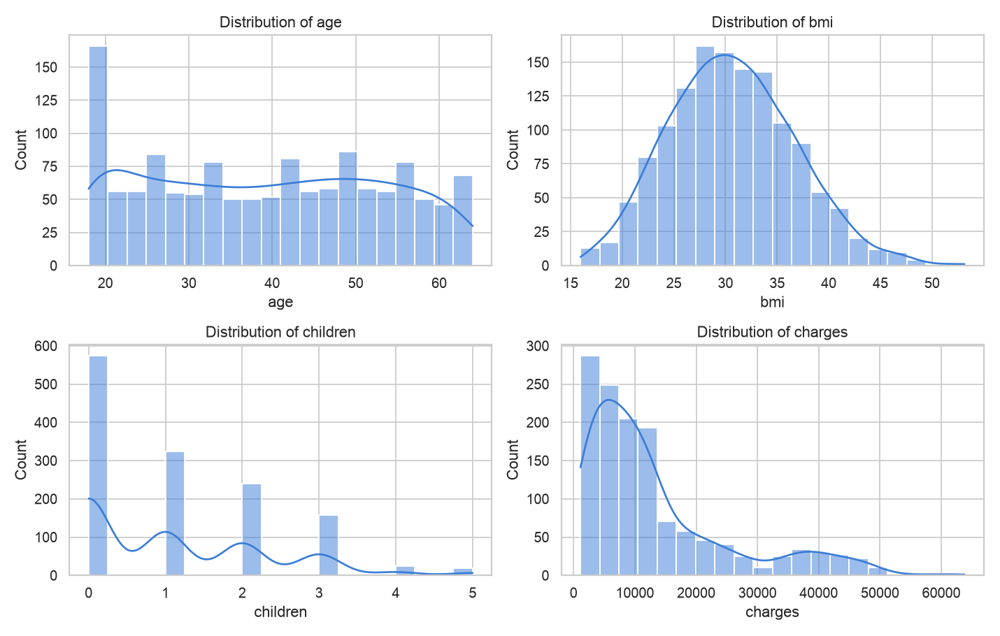
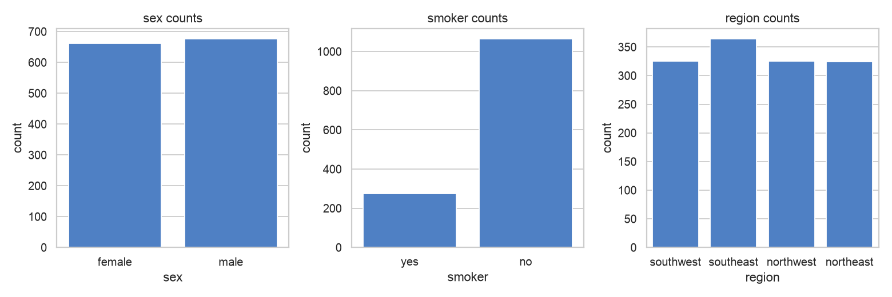
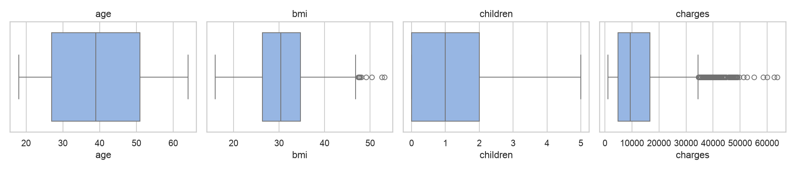
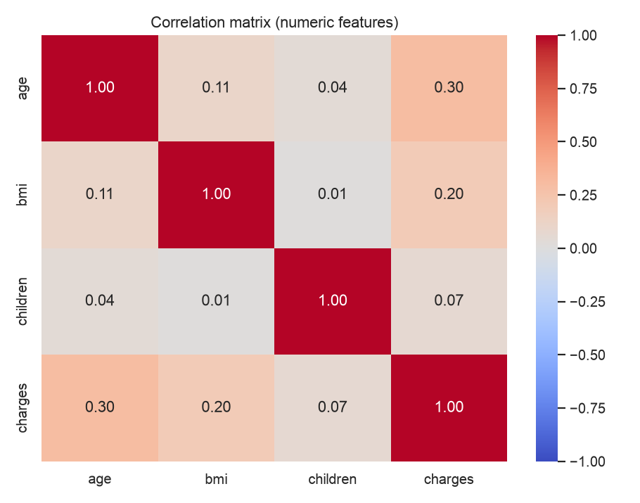
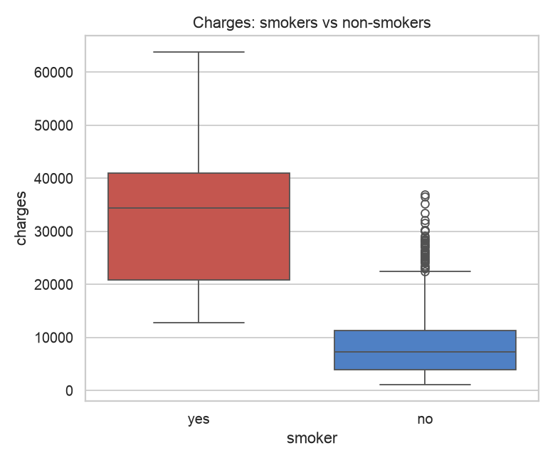
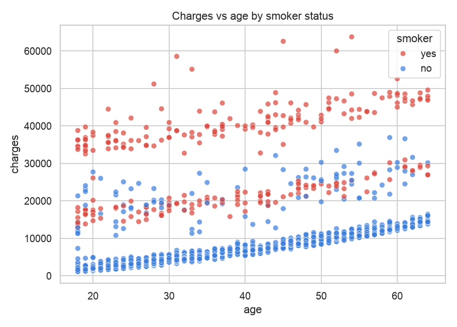
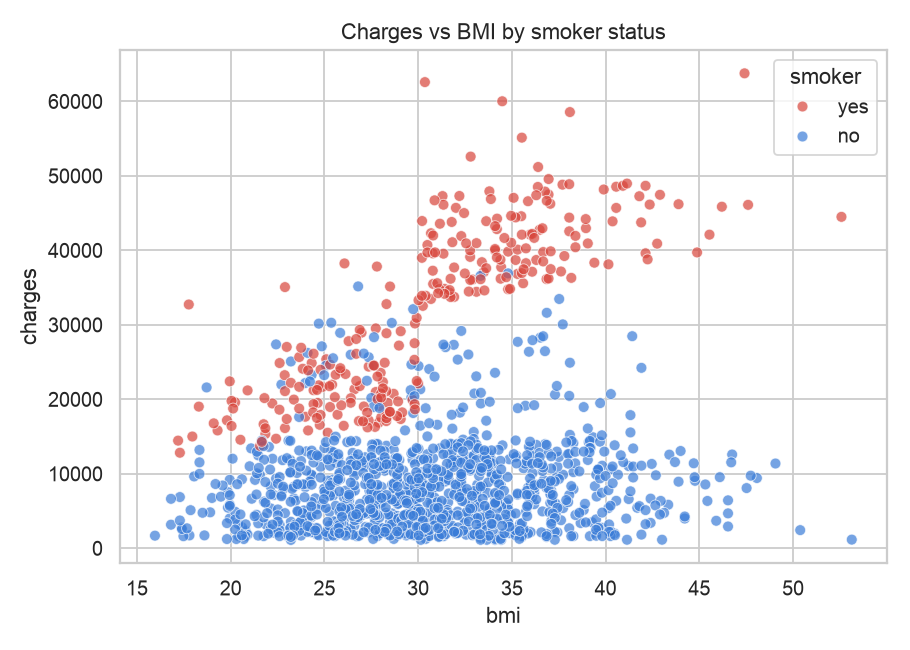
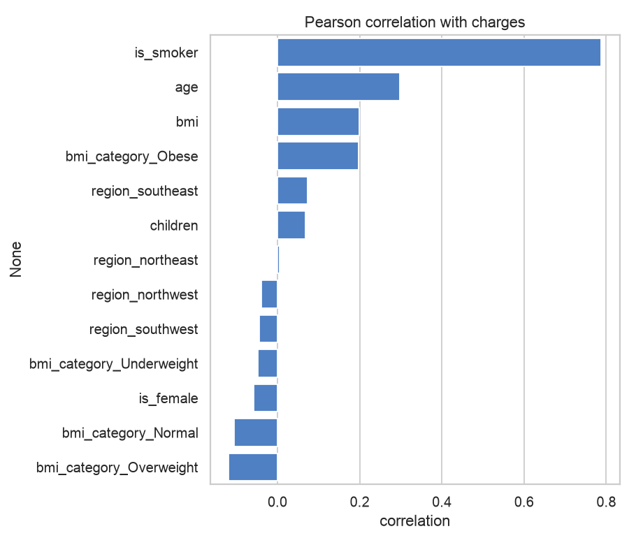

# Medical Insurance Charges: EDA & Feature Engineering

Exploratory data analysis and preprocessing pipeline for predicting individual medical insurance charges from demographic and lifestyle attributes (age, BMI, smoking status, region, etc.)

## Dataset

[`data/insurance.csv`](data/insurance.csv): 1,338 records, 7 columns, no missing values.

| Column | Description |
|---|---|
| `age` | Age of the policyholder (18-64) |
| `sex` | `male` / `female` |
| `bmi` | Body mass index |
| `children` | Number of dependents (0-5) |
| `smoker` | `yes` / `no` |
| `region` | US region: northeast, northwest, southeast, southwest |
| `charges` | Medical insurance cost billed (target) |

## Project Structure

```
Insurance/
├── data/insurance.csv
├── Images/              # plots used in this README
├── insurance.ipynb      # full analysis notebook
└── README.md
```

## Workflow

1. **EDA**: shape, dtypes, summary statistics, null check, distributions, count plots, box plots, correlation heatmap.
2. **Cleaning & preprocessing**: dropped 1 duplicate row (1338 → 1337), label-encoded `sex` → `is_female` and `smoker` → `is_smoker`, one-hot encoded `region`.
3. **Feature engineering**: binned BMI into `Underweight / Normal / Overweight / Obese` (one-hot encoded), standard-scaled `age`, `bmi` and `children`.
4. **Feature selection**: Pearson correlation of every feature with `charges`, plus chi-square tests of independence against charges binned into quartiles.

## Exploratory Analysis

### Distributions
`charges` is strongly right-skewed (mean ≈ $13.3k, median ≈ $9.4k, max ≈ $63.8k), while `age` is roughly uniform and `bmi` is approximately normal around 30.



### Categorical balance
Sex and region are well balanced; smokers are a minority (~20%).



### Outliers
`bmi` and `charges` have noticeable high-end outliers.



### Correlations


## Key Findings

**Smoking is by far the strongest driver of cost.** Smokers pay several times more than non-smokers (Pearson r ≈ 0.79 with charges).



**Age raises charges steadily, and smokers sit in a separate, much higher band.**



**BMI matters mostly in combination with smoking.** Smokers with high BMI (obese range) form the highest-cost cluster.



### Feature correlation with charges

| Feature | Pearson r |
|---|---|
| `is_smoker` | 0.79 |
| `age` | 0.30 |
| `bmi` / `bmi_category_Obese` | ~0.20 |
| `region_southeast` | 0.07 |
| `children` | 0.07 |
| `is_female` | -0.06 |

Chi-square tests (charges binned into quartiles) show `is_smoker`, `age`, `children`, `region_southeast` and `is_female` are significantly associated with charges (p < 0.05).



> The chart is computed on the unrounded BMI, so values differ marginally from the notebook, where encoded columns are cast to `int`.

## Tech Stack

Python, pandas, NumPy, seaborn, matplotlib, scikit-learn, SciPy.

## How to Run

```bash
pip install pandas numpy seaborn matplotlib scikit-learn scipy jupyter
jupyter notebook insurance.ipynb
```

Run the notebook from the `Insurance/` folder so the `data/insurance.csv` path resolves.

## Next Steps

- Train and compare regression models (Linear Regression, Random Forest, Gradient Boosting) to predict `charges`.
- Model a `smoker × bmi` interaction and log-transform the skewed target.
- Evaluate with cross-validation (RMSE, R²).
